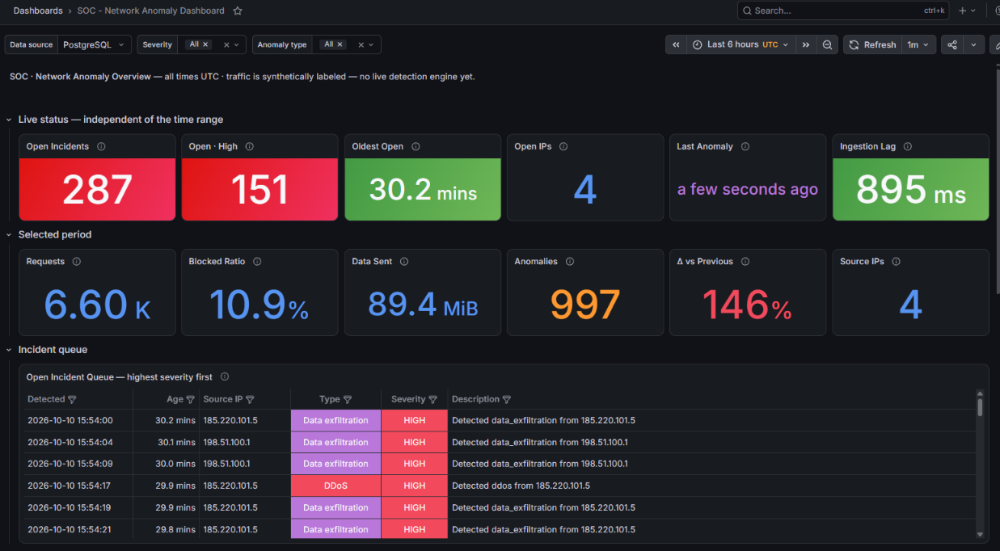
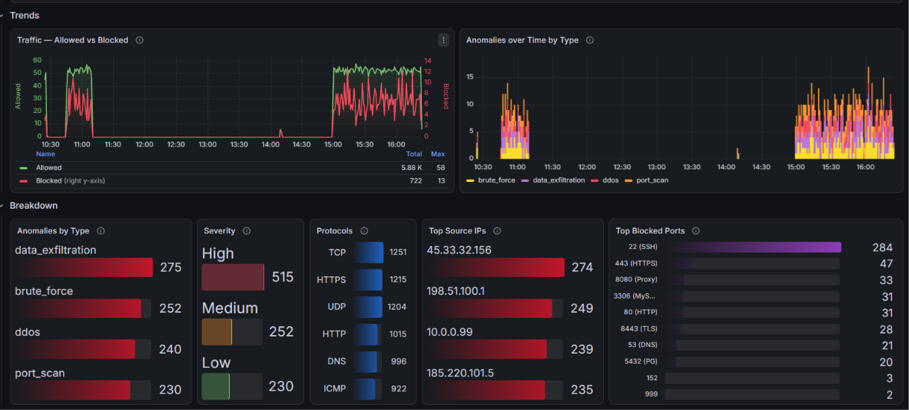
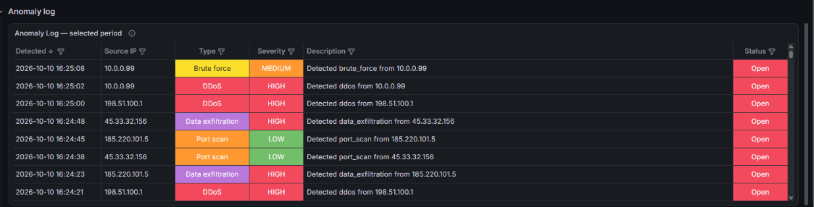
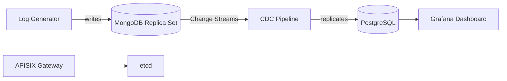

# Network Anomaly Detection Platform

[](https://github.com/nourchtourouu-arch/network-anomaly-platform/actions/workflows/ci.yml)
[](https://github.com/nourchtourouu-arch/network-anomaly-platform/actions/workflows/integration.yml)
[](https://github.com/nourchtourouu-arch/network-anomaly-platform/actions/workflows/security.yml)
[](LICENSE)
[](docker-compose.yml)

A containerized Security Operations Center (SOC) reference platform for real-time network traffic ingestion, rule-based anomaly detection, and operational monitoring. The system demonstrates a Change Data Capture (CDC) pipeline from a document store to a relational analytical store, fronted by a live monitoring dashboard and protected by a WAF gateway.

**Status:** Portfolio / demonstration project. Not intended for production deployment without the hardening steps described in [Security Considerations](#7-security-considerations).

---


*Live status row (independent of the selected time range) and the open incident queue, highest severity first.*


*Allowed vs. blocked traffic over time, anomaly volume by type, and breakdowns by severity, protocol, source IP, and blocked port.*


*Full anomaly log for the selected time range, filterable by severity and type.*

---

## 1. System Overview

The platform ingests simulated network traffic, replicates it through a CDC pipeline into an analytical database, and exposes the resulting dataset through a monitoring dashboard. A reverse proxy / WAF component demonstrates request-level traffic filtering independent of the data pipeline.

### 1.1 Architecture



### 1.2 Component Responsibilities

| Component | Responsibility |
|---|---|
| Log Generator | Produces synthetic network traffic records (normal and anomalous) and writes them to MongoDB. |
| MongoDB (Replica Set) | Primary ingestion store. Replica set mode is required to expose Change Streams. |
| CDC Pipeline | Subscribes to MongoDB Change Streams and replicates each inserted document into PostgreSQL, with retry and exponential backoff on connection loss. |
| PostgreSQL | Analytical store queried by the dashboard. Indexed for time-range and status-filter access patterns. |
| Grafana | Visualization and alerting layer. Connects to PostgreSQL through a dedicated read-only role; alert rules are provisioned from files. |
| APISIX + etcd | Gateway layer demonstrating rate limiting, IP-based blocking, and request filtering. Operates independently of the data pipeline described above. |

---

## 2. Technology Stack

| Layer | Technology | Version |
|---|---|---|
| Data generation | Python, PyMongo | 3.12 / 4.20.0 |
| Ingestion store | MongoDB (Replica Set) | 7.x |
| CDC pipeline | Python, psycopg2 | 3.12 / 2.9.13 |
| Analytical store | PostgreSQL | 16.x |
| Visualization | Grafana | 13.2.2 |
| Gateway / WAF | Apache APISIX | 3.9.0 |
| Configuration store | etcd | 3.5.0 |
| Orchestration | Docker Compose | — |

---

## 3. Prerequisites

- Docker Engine and Docker Compose v2
- Minimum 2 GB of available RAM
- Ports `3000`, `5432`, `9080`, `9092`, `9180`, `9443`, `27017`, `2379` available on the host

---

## 4. Deployment Procedure

### 4.1 Configuration

Clone the repository and create the environment file from the provided template:

```bash
git clone https://github.com/nourchtourouu-arch/network-anomaly-platform.git
cd network-anomaly-platform
cp .env.example .env
```

Edit `.env` and set values for all required variables:

| Variable | Purpose |
|---|---|
| `POSTGRES_DB` | Database name |
| `POSTGRES_USER` | Application (read-write) database user |
| `POSTGRES_PASSWORD` | Password for the application user |
| `GRAFANA_ADMIN_PASSWORD` | Grafana administrator password |
| `GRAFANA_RO_PASSWORD` | Password assigned to the read-only `grafana_ro` role |
| `APISIX_ADMIN_KEY` | Admin API key for the APISIX gateway. Must be rotated from the default before exposing the admin API beyond localhost. |
| `SLACK_WEBHOOK_URL` | Optional. Incoming webhook URL for Slack alerting on high-severity anomalies (see [§5](#5-dashboard-design-notes)). Leave empty to disable — the pipeline runs normally either way. Also read by Grafana if you enable the optional Slack routing (see [§5](#5-dashboard-design-notes)). |

No credentials are stored in source control. `.env` is excluded via `.gitignore`.

### 4.2 Startup

```bash
docker compose up --build
```

This provisions all services, initializes the MongoDB replica set, applies the PostgreSQL schema (`sql/init.sql`), and auto-provisions the Grafana datasource and dashboard.

### 4.3 Post-Deployment Hardening

Create the read-only PostgreSQL role used by Grafana, and apply the indexes the dashboard depends on:

```bash
docker exec -i postgres psql -U "$POSTGRES_USER" -d "$POSTGRES_DB" \
  -v grafana_ro_password="$GRAFANA_RO_PASSWORD" < sql/db-setup.sql
docker restart grafana
```

This step is idempotent and safe to re-run.

Provision the WAF routes (rate limiting, path blocking, IP blocking) into etcd through the APISIX Admin API — without this step, APISIX runs but enforces no rules:

```bash
set -a; source .env; set +a
./waf/provision-routes.sh
```

Also idempotent: it applies the same route/upstream definitions on every run via fixed resource IDs.

### 4.4 Service Endpoints

| Service | Endpoint | Authentication |
|---|---|---|
| Grafana dashboard | `http://localhost:3000` | `admin` / `GRAFANA_ADMIN_PASSWORD` |
| APISIX gateway | `http://localhost:9080` | — |
| APISIX Admin API | `http://127.0.0.1:9180` | `X-API-KEY: APISIX_ADMIN_KEY`. Bound to localhost only (see [Security Considerations](#7-security-considerations)). |
| PostgreSQL | `localhost:5432` | Values from `.env` |
| MongoDB | `localhost:27017` | — |

---

## 5. Dashboard Design Notes

The Grafana dashboard is built to be time-range-correct and filterable, not a static snapshot:

- `$severity`, `$anomaly_type`, and `$datasource` are live template variables bound into every panel query, not decorative filters.
- All time-series panels use the `$__timeFilter` / `$__timeGroup` macros so the dashboard time picker behaves correctly.
- A dedicated **Live Status** row (open incident count, backlog age, ingestion lag) is intentionally independent of the selected time range, since operational status should not be hidden by a narrow window selection.
- Grafana connects through the least-privilege `grafana_ro` role rather than the pipeline's read-write user.

Alerting works at two levels:

- **Per event (CDC pipeline).** The pipeline pushes a throttled Slack alert (one per 10-second window, at most) whenever it commits a high-severity anomaly — configured via the optional `SLACK_WEBHOOK_URL` variable.
- **Trend and health (Grafana).** Two alert rules are provisioned from `grafana/provisioning/alerting/rules.yml` and evaluated every minute: `High-severity anomaly spike` (more than 5 high-severity anomalies in 5 minutes) and `CDC pipeline stale` (no new row in `network_logs` for over 2 minutes — an outage the per-event alert cannot see, since it only fires when events arrive).

Routing the Grafana rules to Slack is opt-in: Grafana refuses to start with a Slack contact point whose webhook URL is empty, so it ships as an example file rather than being loaded by default.

```bash
cp grafana/provisioning/alerting/slack.yml.example grafana/provisioning/alerting/slack.yml
docker restart grafana
```

Without it, the rules still evaluate and show up under **Alerting → Active notifications** in Grafana.

---

## 6. Repository Structure

```
network-anomaly-platform/
├── .github/
│   ├── workflows/
│   │   ├── ci.yml            Lint, config validation, image build
│   │   ├── integration.yml   End-to-end pipeline test (stack up, CDC restart)
│   │   └── security.yml      Secret scan (gitleaks), image scan (Trivy)
│   └── dependabot.yml        Dependency update policy
├── generator/                Traffic simulation service
│   ├── log_generator.py
│   ├── requirements.txt
│   └── Dockerfile
├── cdc/                      CDC replication service (+ Slack alerting)
│   ├── cdc_pipeline.py
│   ├── requirements.txt
│   └── Dockerfile
├── sql/
│   ├── init.sql              Schema definition
│   └── db-setup.sql          Read-only role and index provisioning
├── grafana/
│   └── provisioning/
│       ├── datasources/      Auto-provisioned PostgreSQL connection
│       ├── dashboards/       Auto-provisioned dashboard definition
│       └── alerting/         Alert rules (+ optional Slack routing)
├── waf/                      APISIX route and plugin configuration
├── tests/
│   └── integration.sh        Mongo → CDC → PostgreSQL test, run by CI
├── docker-compose.yml
├── .env.example
├── .gitleaks.toml            Secret-scan configuration
├── LICENSE
└── README.md
```

### 6.1 Automated Checks

Every push and pull request runs three GitHub Actions workflows:

| Workflow | What it checks |
|---|---|
| `ci.yml` | Python lint (syntax errors and undefined names), YAML and dashboard-JSON validation, Docker image builds, `docker compose config`. |
| `integration.yml` | Starts the real stack (MongoDB, CDC, generator, PostgreSQL) and verifies, end to end: the replica set initialises and `mongo-init` is idempotent; documents reach PostgreSQL with fresh timestamps and the expected severities; after a CDC restart, nothing inserted while it was down is lost or duplicated (resume-token persistence). On failure it prints the failing check and the service logs. |
| `security.yml` | `gitleaks` scans the full git history for secrets. Trivy scans both images and fails on CRITICAL vulnerabilities that have a fix; HIGH findings and Dockerfile misconfigurations are reported without blocking. Also runs weekly, since new CVEs appear in unchanged base images. |

Dependabot proposes weekly updates for Python dependencies, base images, Compose images and GitHub Actions. Every pull request runs the workflows above, and the integration test is what makes a `pymongo` or `psycopg2` bump safe to merge. Minor and major bumps of the Python base image, Grafana, APISIX and etcd are ignored on purpose: they need a manual test against the dashboards, alert rules and WAF routes.

Third-party code in CI is pinned by commit SHA or by checksum, never by a mutable tag. In March 2026, most `trivy-action` tags and a Trivy release were compromised in a [supply-chain attack](https://snyk.io/articles/trivy-github-actions-supply-chain-compromise/), so CI installs Trivy v0.69.3 (a release that predates the incident) from its `.deb` package, verified against a pinned SHA-256, instead of using `trivy-action`. gitleaks is installed the same way.

---

## 7. Security Considerations

This project is a demonstration of the described patterns and is not hardened for production use as-is. Known limitations:

- The APISIX admin API key shipped in `waf/config.yaml` is the publicly documented default value and must be rotated before the admin API is exposed beyond localhost.
- `source_ip` fields in generated traffic are synthetic. In a real deployment behind a load balancer or reverse proxy, IP attribution requires explicit `X-Forwarded-For` handling and a trusted proxy allowlist.
- Anomaly classification is rule-based (static thresholds and patterns), not model-driven. See [Roadmap](#8-roadmap).
- TLS is not configured between internal services; all inter-service traffic is unencrypted, which is acceptable for local demonstration only.
- `waf/apisix.yaml` documents the intended WAF routes (rate limiting, IP blocklist, path-based filtering) as a human-readable reference. APISIX runs in `traditional` mode with etcd as the config store, so this file is never read at runtime — `waf/provision-routes.sh` is what actually pushes the equivalent rules into etcd via the Admin API (see [§4.3](#43-post-deployment-hardening)). Verified live: 100 req/min rate limiting (HTTP 429 past the threshold), blocked file-extension and path-traversal probes (HTTP 403/400).
- The APISIX Admin API (port `9180`) is bound to `127.0.0.1` only in `docker-compose.yml`, not `0.0.0.0` — Docker's default would otherwise expose route-modification access to the local network. `waf/config.yaml`'s `allow_admin` list is intentionally broadened to include the Docker bridge subnet (`172.16.0.0/12`), since traffic from the host reaches the container under that range, not `127.0.0.1`; this is safe only because the host-level binding already blocks all non-local access. MongoDB, PostgreSQL and etcd are bound to `127.0.0.1` the same way; MongoDB and etcd run without authentication in this demo, so they must never be published on a non-local interface.
- The `cdc` and `generator` containers run as root (no `USER` instruction in their Dockerfiles). Trivy reports this as a HIGH misconfiguration (DS-0002) in the non-blocking CI report; running them as a non-root user is on the [Roadmap](#8-roadmap).

---

## 8. Roadmap

- Replace rule-based detection with a trained anomaly-scoring model
- Extend the integration test to the full stack (Grafana alert rules, APISIX WAF routes) so infrastructure image updates are validated too
- Run the application containers as a non-root user
- Add a cloud deployment variant using managed MongoDB and PostgreSQL
- Integrate an external threat intelligence feed (e.g., AbuseIPDB)
- Add simulated incident resolution so long-running demos reflect closed incidents

---

## 9. License

Released under the [MIT License](LICENSE).

---

## 10. Author

**Nour Chtourou** — DevSecOps | Data Pipelines & Security Monitoring

[GitHub](https://github.com/nourchtourouu-arch) · [LinkedIn](https://www.linkedin.com/in/nour-c-548b6a352/)
